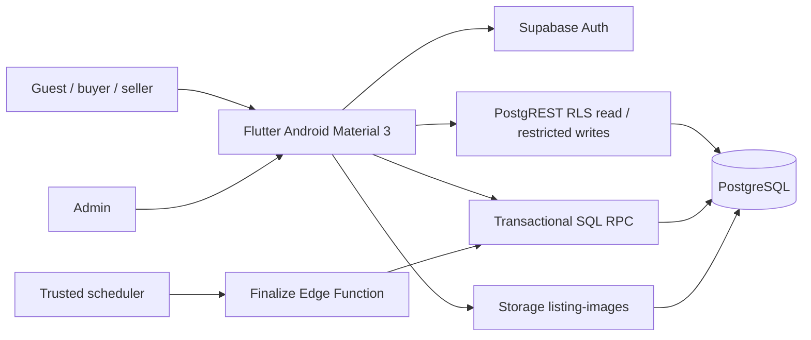
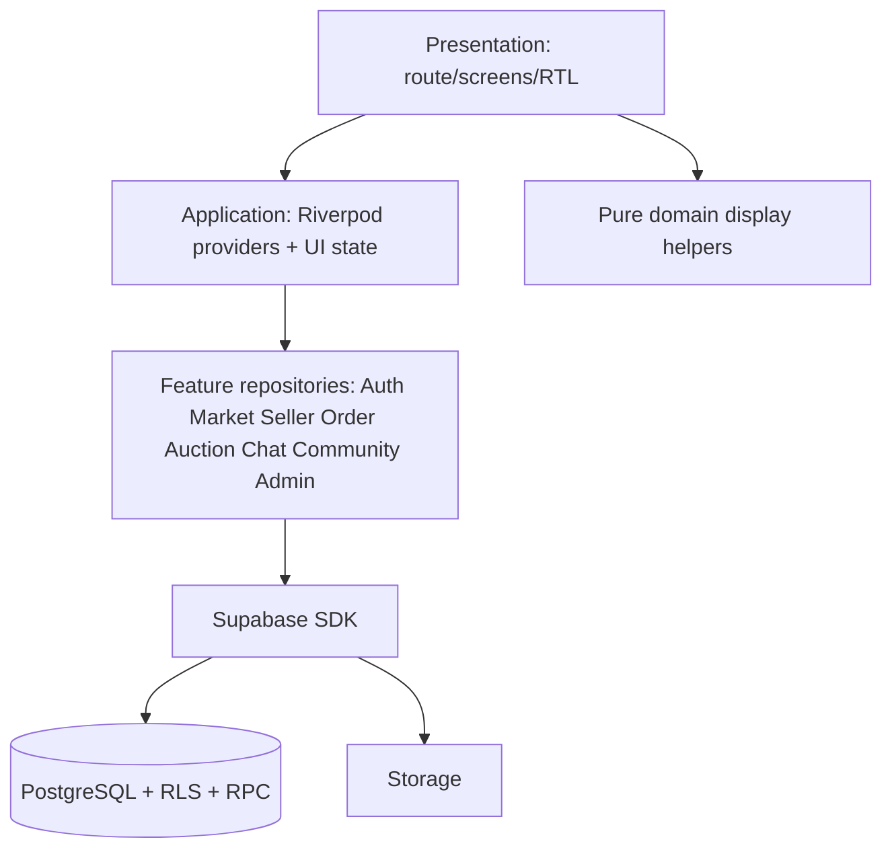
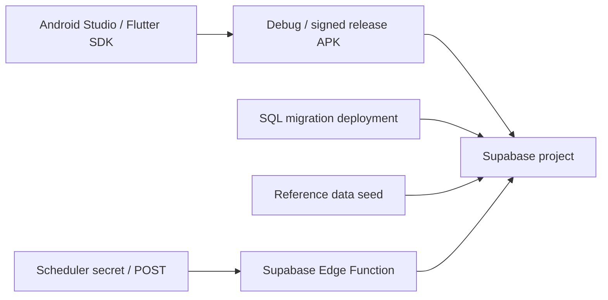

# MARSA Architecture — source v1

## System context

Aden-based guest/buyer/seller/admin accesses the Flutter Android app. All persistent operations go to Supabase Auth, PostgREST, Storage and PostgreSQL. Admin moderation, auction bids, stock reservation, order state changes and seller approval are executed through server-side PostgreSQL functions, not client flags. The scheduled Supabase Edge Function uses a private service-role key to finalize auctions. The mobile app contains only project URL and public key.

## Components

`lib/app`: route composition and protected navigation. `lib/core`: theme, translations, environment, loading/error widgets. `lib/features/*/presentation`: Flutter views and forms. `lib/features/*/data`: feature-scoped repositories with Supabase read and RPC calls. `lib/features/auctions/domain`: non-authoritative display calculations, separately unit-testable. `supabase/migrations`: authoritative business invariants. Only one state-management framework is used: Riverpod. GoRouter handles navigation. No direct database client calls occur inside screen widgets; screen widgets call repository methods via providers.

## Data flows

**Purchase:** buyer authenticates → checkout collects quantity, Aden area, payment/collection description → `place_order` server RPC locks a listing row → validates seller, quantity and idempotency key → decrements available stock and snapshots title/unit/price in the same transaction → creates order/history/notification. Rejection/cancellation restores stock once using `stock_released_at` under order row lock.

**Auction:** listing/auction publicly browsed → signed-in buyer posts bid through `place_bid` → SQL locks auction row, validates server clock, minimum increment and eligibility, records immutable bid, updates authoritative current price and inserts notifications → scheduler/on-demand `finalize_auction` closes outcome → creates a pending order for winner or no-winner final state. Bidding is never allowed using offline cached details.

**Moderation:** seller application creates PENDING profile → trusted administrator RPC approves/rejects → approved seller creates listing DRAFT using `create_listing` RPC → submits to PENDING_REVIEW → administrator publishes ACTIVE via RPC → public users can browse.

**Messages:** signed-in buyer calls `start_conversation` with an active listing → SQL registers both participants → RLS and server helper ensure only participants read or send → block-trigger forbids further messages after a block.

## Security boundaries

- PostgreSQL RLS is mandatory on private tables; grants are deliberately narrow and trigger/definer RPCs validate authorization and state transitions.
- `mars_private.admin_users` is not granted to mobile roles and must only be changed from Supabase's trusted SQL context.
- Seller verification data is split into a private table; public approved seller records expose only public business fields.
- Bid history shown to public omits bidder identities; current bidder UUID is not granted to anon/authenticated users.
- Public listing images and private documents are separate Storage buckets with owner/path policies.
- No service-role key, database password, verified payment claim, wallet, crypto or tracking integration exists in Flutter.
- Backend rate limits cover message/report insertion; Supabase Auth handles its own rate controls. Bidding abuse protection requires further operational hardening at scale.

## Deployment

## Deliberate design trade-offs

- Feature-scoped repository classes; PostgreSQL RPCs carry critical business authority. This avoids a heavyweight separate API service for MVP.
- `shared_preferences` caches recently viewed **public** listing details only, read-only when unreachable; checkout/bidding still requires server authority.
- In-app notification records are persisted. Push/FCM and delivery networks are **not** configured without platform credentials.
- English translations cover common navigation/actions, but this source version includes Arabic-only explanatory and admin content requiring translation pass before fully bilingual release.
- This source artifact is **not** an operational deployment; no device, Android Studio, Supabase project, email deliverability or live scheduler was available for end-to-end verification.
