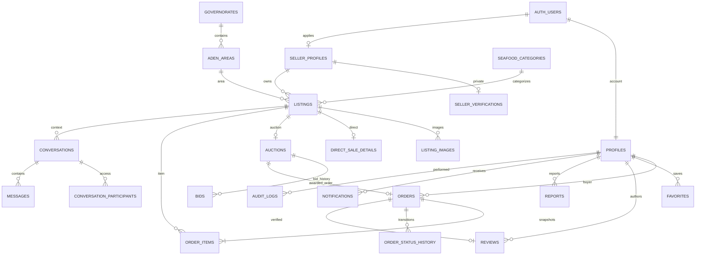
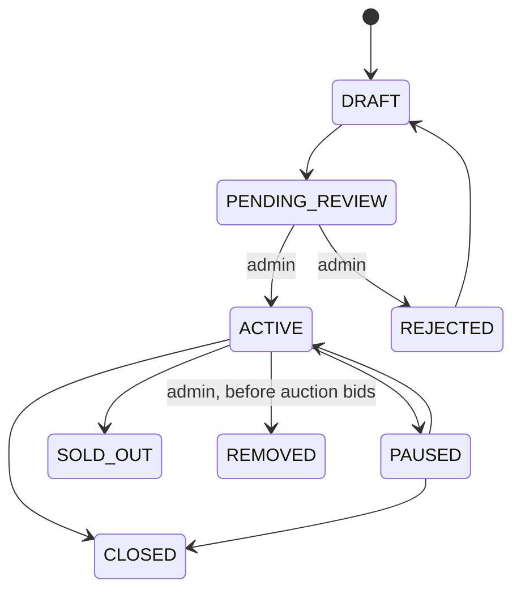
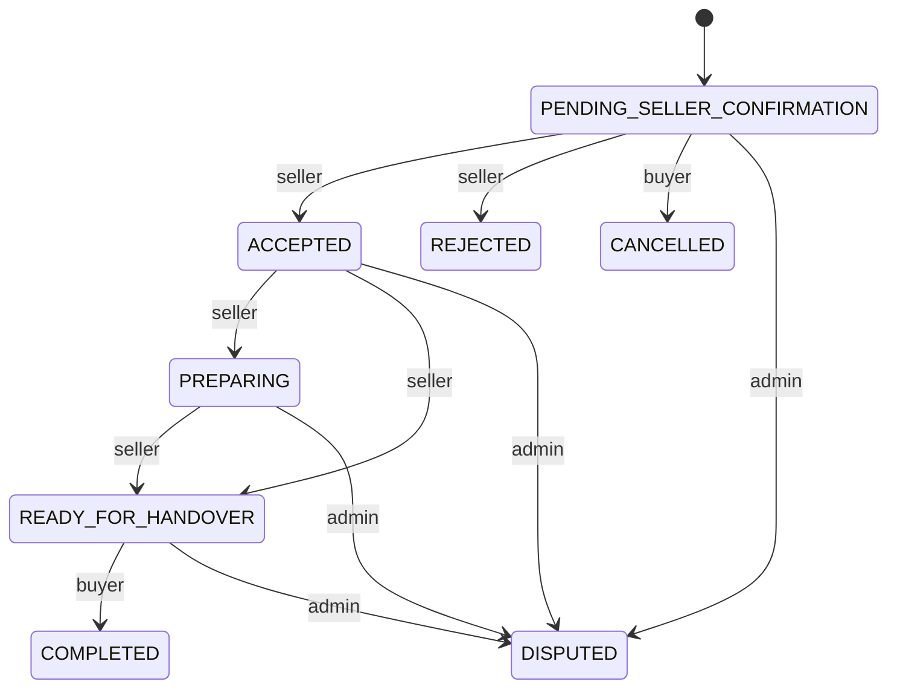
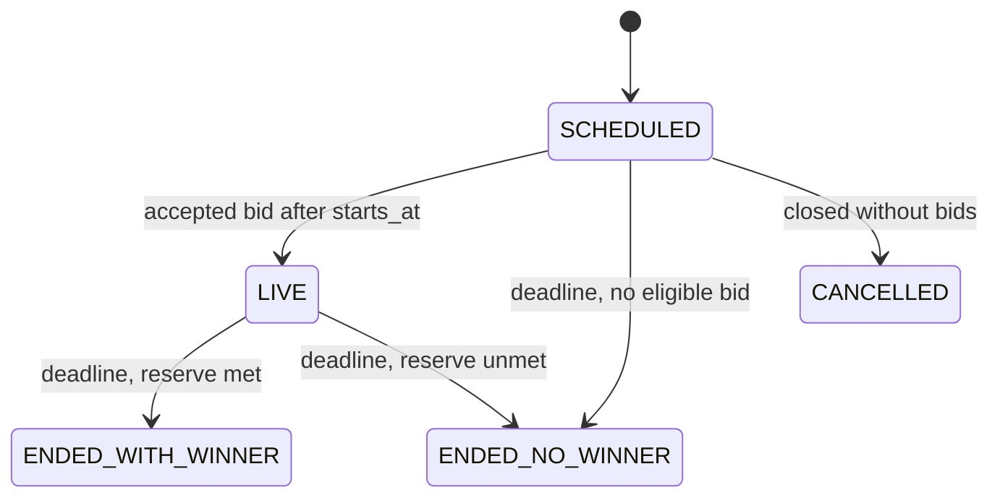

# MARSA PostgreSQL — versioned schema

The authoritative definitions and grants are SQL files `supabase/migrations/202611190001...004...`. PostgreSQL UUID PKs, timestamp columns, indexes, triggers, numeric amount and quantity checks, foreign keys, unique constraints and RLS underpin the marketplace. `auth.users` stores secure identity and links to `profiles`.

## ERD (principal relations)

## Cardinalities and constraints

- One account → one profile, zero/one seller profile, zero/one private verification record. `mars_private.admin_users` is private and user-specific.
- Each governorate → many areas; Aden is only enabled governorate in seed, areas unique within governorate. Each category → many listings.
- Each listing → zero/many images and **exactly one** direct-sale OR auction detail at completion of `create_listing` RPC. `listings.sale_type` immutable, audit/constraint enforced.
- Each auction → many immutable bids. Unique `(bidder_id,request_id)` avoids retried bid duplicates; `auction.current_bidder_id` is not readable by guest/buyer.
- Each order → one/many order items (MVP: one), one/many status records, optional one review. Unique `(buyer_id,idempotency_key)` and `order_number`. `stock_released_at` marks one-time return.
- Each conversation → two participants; uniqueness `(listing_id,buyer_id,seller_id)`; participant access to messages and conversation metadata only.
- Each user + listing favorite has unique composite PK. `reviews.order_id UNIQUE` and rating 1..5; review RLS verifies completed buyer-owned order.
- Private verification data/docs, personal profile phone, admin logs and messages are protected by RLS.

## Critical indexes

`listings_feed_idx(status,sale_type,created_at DESC)`; `listings_seller_idx`; `listings_area_category_idx`; `auctions_expiry_idx(status,ends_at)`; `bids_auction_time_idx`; `bids_bidder_idx`; `orders_buyer_idx`, `orders_seller_idx`; `notifications_recipient_idx`; `messages_conversation_idx`. FK indexes and uniqueness indexes are also present. Additional search indexes (trigram/full text for mixed Arabic/English) should be added when volume justifies it.

## RLS matrix

| Table family | Read access | Mutations from authenticated users |
|---|---|---|
| governorates / aden_areas / seafood_categories | Enabled/active for guests, admin may see inactive | Admin `admin_reference` RPC only |
| profiles | Owner and admin only | Owner display name, private phone, area, language (limited columns); admin status RPC |
| seller_profiles | Approved public, owner/admin may see pending | Owner apply/update public business fields; approval only admin RPC |
| seller_verifications | Owner/admin | Owner private verification data, restricted Storage uploads |
| listings / listing_images / direct_sale_details | ACTIVE public, seller own, admin | Seller limited listing columns, own images; creation/status/stock/price RPCs |
| auctions | Public auction economic data only; no public bidder IDs | Server RPC only |
| bids | Own bid history/admin (public aggregate RPC strips IDs) | Server `place_bid` only, immutable trigger |
| orders / items / history | Buyer/seller of order/admin | `place_order`/`transition_order` RPCs only |
| conversations / participants / messages | Participants (or admin) | Conversation RPC; participant sends message |
| blocked_users | Blocker only | Blocker insert/delete |
| favorites | Owner only | Owner insert/delete |
| reviews | Visible published reviews; author/admin can see hidden | Authenticated verified completed-order buyer inserts once |
| reports | Reporter/admin | Reporter inserts; admin resolves via RPC |
| notifications | Recipient only | Recipient may mark read only |
| audit_logs | Admin only | Server-side functions append only |

## State machines

## Transactions and error handling

- `place_order` acquires `SELECT ... FOR UPDATE` on listing and double-checks idempotency key before modifying stock. Same-key retries return original order; status cancellation will not produce a second purchase.
- `transition_order` locks order; rejected/cancelled direct orders restore quantity if `stock_released_at IS NULL`, set it in same transaction. Repeating rejected/cancelled transition is invalid.
- `place_bid` locks auction before reading latest bid, requires current server time within start/end, validates amount and eligible buyer, writes immutable bid and current price together. Outdated competing bids get an exception. Public `auction_activity` strips bidder identity.
- `finalize_auction` takes auction row lock and returns final status if already processed. After expiry without valid reserve -> ENDED_NO_WINNER; otherwise creates pending award order and winner deadline. Expired winner does not secretly transfer win to runner-up; scheduler marks order EXPIRED and logs default.
- `finalize_due_auctions` and `expire_stale_direct_orders` are executable by server-side `service_role` only; on-demand `finalize_auction` cannot finalize early.
- Direct pending seller confirmations expire after 24 hours through `expire_stale_direct_orders`; the same worker returns reserved inventory exactly once.
- **Operational limitation:** no scheduled job is installed merely by running the SQL migrations; deploy/schedule the function separately as documented in README.
